# Cobertura de los datos de 2010

> Informe generado por `npm run datos:construir` a partir de `public/data/paises-2010.json`.
> No se edita a mano: se regenera cada vez que cambian los datos.

## Resumen

- **223 países y territorios**: 193 Estados soberanos (los 192 miembros de la ONU el 1 de enero de 2010 y el Vaticano), 9 territorios de estatus especial o en disputa y 21 territorios dependientes. **221 son jugables.**
- **64 campos por país** (14.272 valores en total).
- **75,8 % son datos reales**, 9,3 % son estimaciones y 14,9 % no tienen dato.
- **212 países tienen población y PIB reales** (la Fase 1 exige al menos 190).
- De los 2.127 valores sin dato, 2.077 son reservas minerales de países que la fuente no lista; el resto, producción minera de territorios que la fuente no cubre.
- Como en 2010, Sudán aparece unido (sus cifras suman las de Sudán y Sudán del Sur) y también las Antillas Neerlandesas (Curazao y Sint Maarten).

**Fuentes y fecha de descarga**

- Banco Mundial, World Development Indicators (API v2) — descargado el 12/11/2026
- FMI, Perspectivas de la economía mundial (WEO), vía DataMapper API — descargado el 12/11/2026
- Our World in Data, energy-data (Ember, Energy Institute, EIA) — descargado el 12/11/2026
- Our World in Data, co2-data (Global Carbon Project y otros) — descargado el 12/11/2026
- Our World in Data: Energy Institute y EIA (reservas fósiles); USGS y BGS (minerales) — descargado el 12/11/2026
- FAO, vía Banco Mundial (AG.LND.TOTL.K2), servida por Our World in Data — descargado el 12/11/2026
- Wikidata y Banco Mundial (población de los territorios sin datos oficiales).

## Cómo leer este informe

- **Dato real:** viene de una fuente, con su año (se prefiere 2010; si falta, 2009 o 2008).
- **Estimación (\*):** valor de respaldo calculado, nunca un dato real. En el juego irá marcado.
- **Sin dato (—):** ni la fuente lo da ni hay una forma razonable de estimarlo.
- **†** Territorio de estatus especial o en disputa. **‡** Territorio dependiente.

## Datos principales por país

Para revisar de un vistazo los países que conozcas. PIB en millones de dólares de 2010.

| País | Capital | Población | PIB (M$) | PIB per cápita ($) | Paro (%) | Inflación (%) | Deuda (% PIB) | Datos reales |
| --- | --- | --: | --: | --: | --: | --: | --: | --: |
| 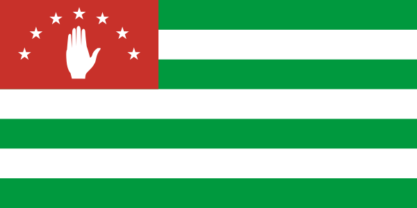 Abjasia † | Sujumi | 247.432 \* | 752 \* | 3.040 \* | 6,7 \* | 7,8 \* | 28,5 \* | 0,0 % |
| 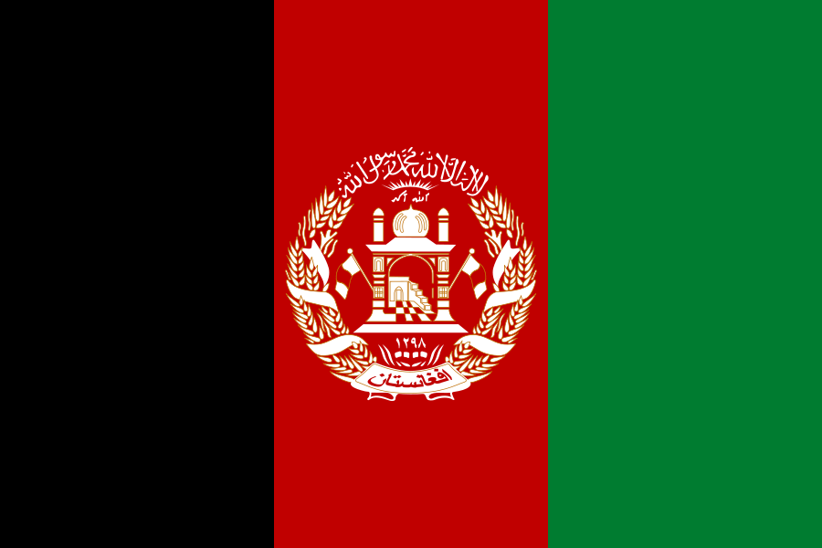 Afganistán | Kabul | 28.284.100 | 15.857 | 561 | 7,8 | 2,2 | 7,7 | 82,8 % |
| 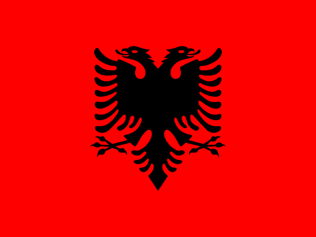 Albania | Tirana | 2.913.020 | 12.087 | 4.149 | 14,1 | 3,6 | 57,7 | 84,4 % |
| 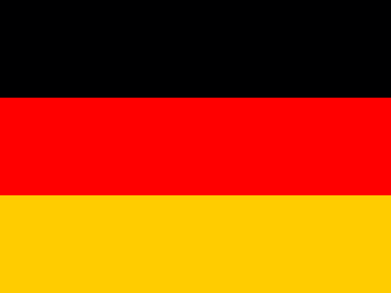 Alemania | Berlín | 81.776.900 | 3.467.090 | 42.397 | 7,0 | 1,1 | 81,0 | 82,8 % |
| 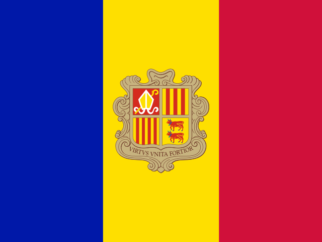 Andorra | Andorra la Vieja | 80.706 | 3.450 | 42.747 | 3,0 | 1,7 | 35,0 | 46,9 % |
| 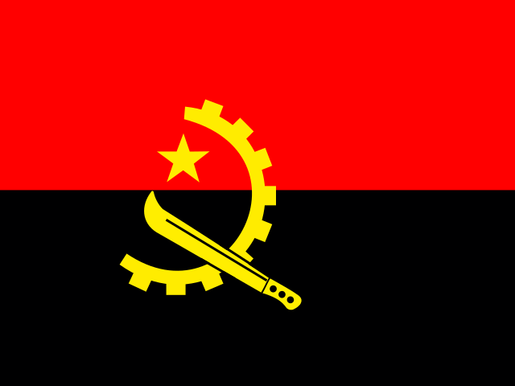 Angola | Luanda | 23.294.800 | 95.547 | 4.102 | 16,6 | 14,5 | 32,6 | 82,8 % |
| 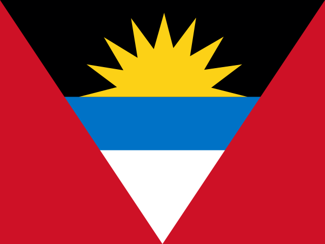 Antigua y Barbuda | Saint John | 85.320 | 1.298 | 15.217 | 10,7 \* | 3,4 | 79,4 | 76,6 % |
| 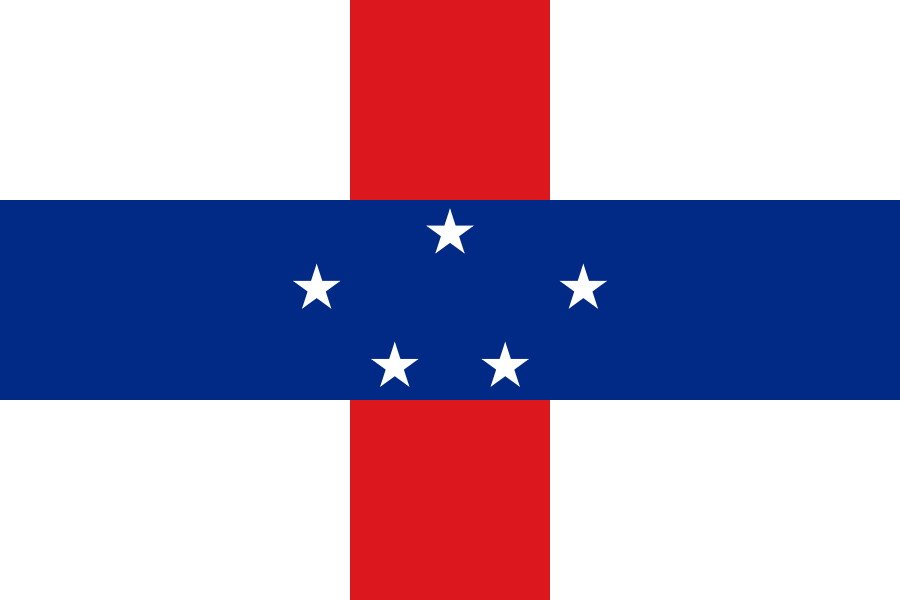 Antillas Neerlandesas ‡ | Willemstad | 182.497 | 3.844 | 21.061 | 10,7 \* | 2,4 | 79,4 \* | 26,6 % |
| 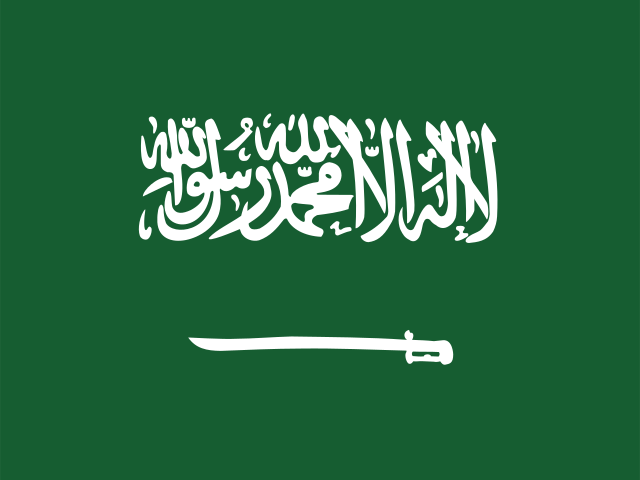 Arabia Saudí | Riad | 23.978.500 | 528.207 | 22.028 | 5,6 | 5,3 | 8,4 | 79,7 % |
| 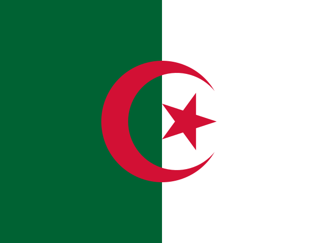 Argelia | Argel | 36.188.200 | 177.785 | 4.913 | 10,0 | 3,9 | 9,5 | 84,4 % |
| 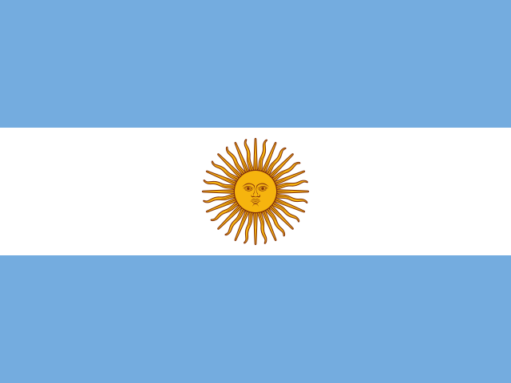 Argentina | Buenos Aires | 41.288.700 | 423.627 | 10.260 | 7,7 | 10,5 | 43,5 | 81,3 % |
| 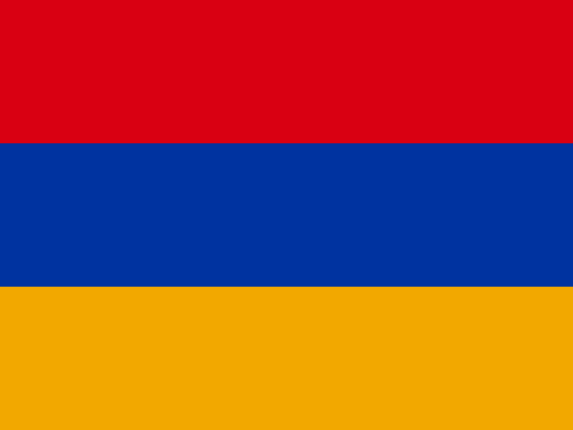 Armenia | Ereván | 3.044.800 | 9.260 | 3.041 | 19,5 | 8,2 | 34,9 | 79,7 % |
| 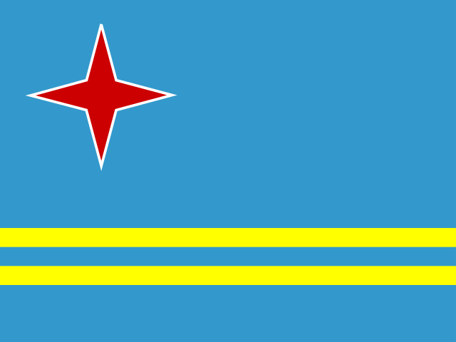 Aruba ‡ | Oranjestad | 101.838 | 2.454 | 24.093 | 10,6 | 2,1 | 54,7 | 79,7 % |
| 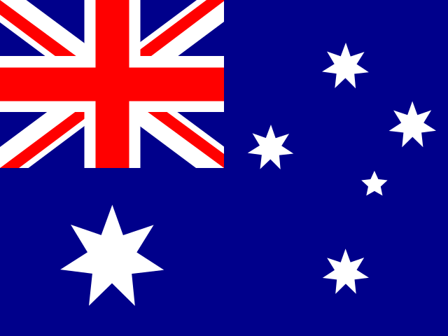 Australia | Canberra | 22.031.800 | 1.152.570 | 52.314 | 5,2 | 2,9 | 20,3 | 79,7 % |
| 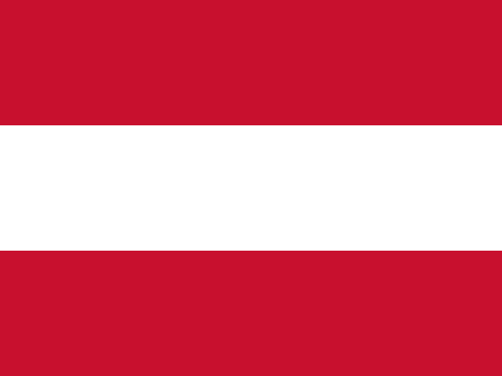 Austria | Viena | 8.363.400 | 389.828 | 46.611 | 4,9 | 1,8 | 83,7 | 82,8 % |
|  Azerbaiyán | Bakú | 9.054.330 | 52.909 | 5.844 | 5,6 | 5,7 | 5,0 | 84,4 % |
| 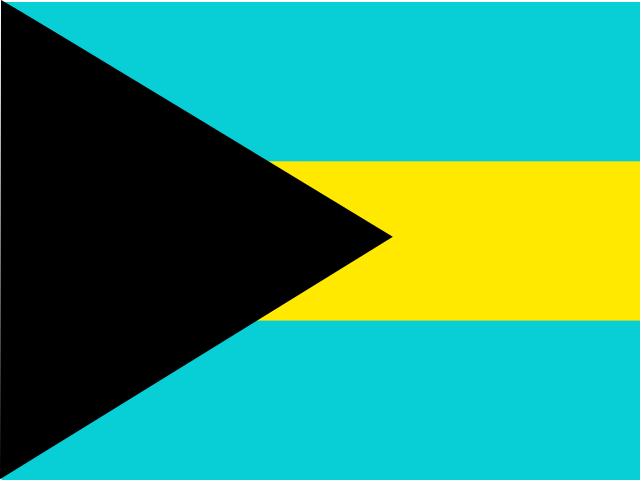 Bahamas | Nasáu | 367.478 | 10.096 | 27.473 | 14,4 | 1,3 | 33,9 | 79,7 % |
| 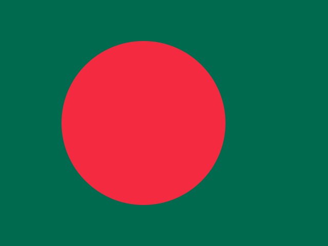 Bangladés | Daca | 152.202.000 | 115.276 | 757 | 3,4 | 8,1 | 29,6 | 84,4 % |
| 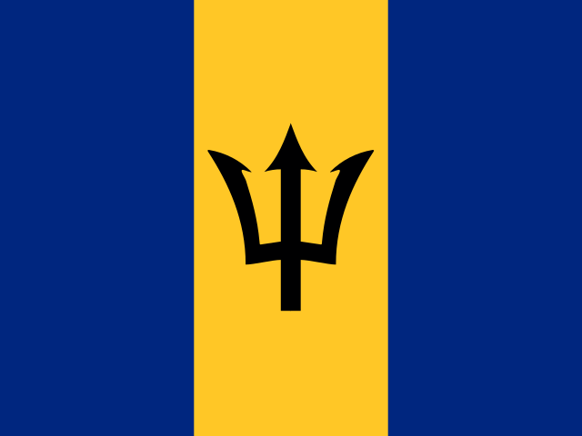 Barbados | Bridgetown | 275.243 | 5.429 | 19.723 | 10,7 | 5,8 | 90,3 | 79,7 % |
| 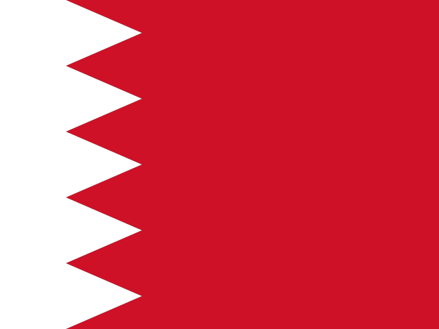 Baréin | Manama | 1.228.540 | 26.806 | 21.819 | 1,1 | 2,0 | 28,8 | 82,8 % |
| 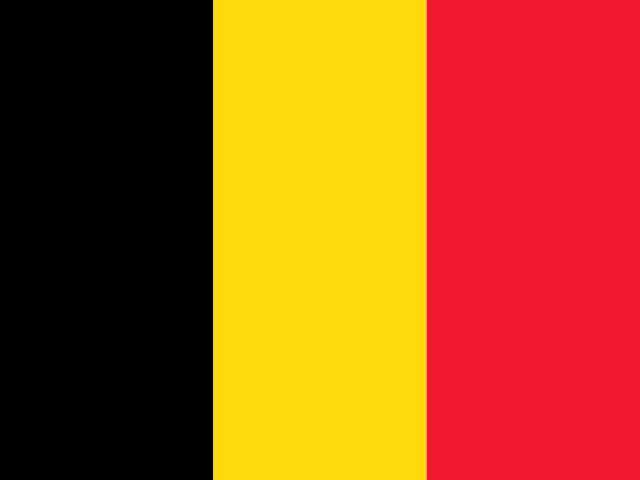 Bélgica | Bruselas | 10.895.600 | 481.557 | 44.197 | 8,3 | 2,2 | 100,2 | 82,8 % |
| 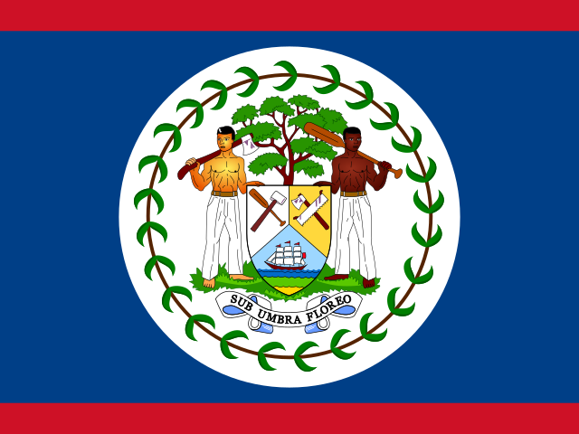 Belice | Belmopán | 320.245 | 1.749 | 5.461 | 8,4 | 0,9 | 68,4 | 82,8 % |
| 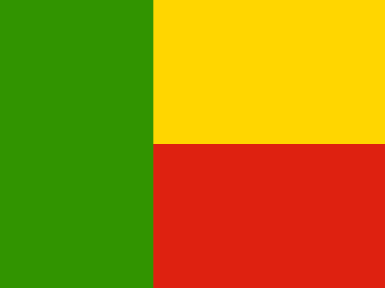 Benín | Porto Novo | 9.797.480 | 9.535 | 973 | 1,0 | 2,2 | 21,0 | 84,4 % |
| 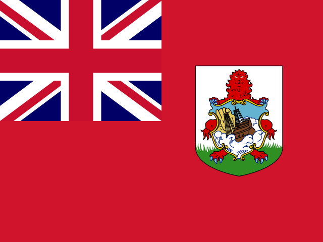 Bermudas ‡ | Hamilton | 63.725 | 6.635 | 104.112 | 7,2 \* | 1,8 \* | 53,7 \* | 68,8 % |
| 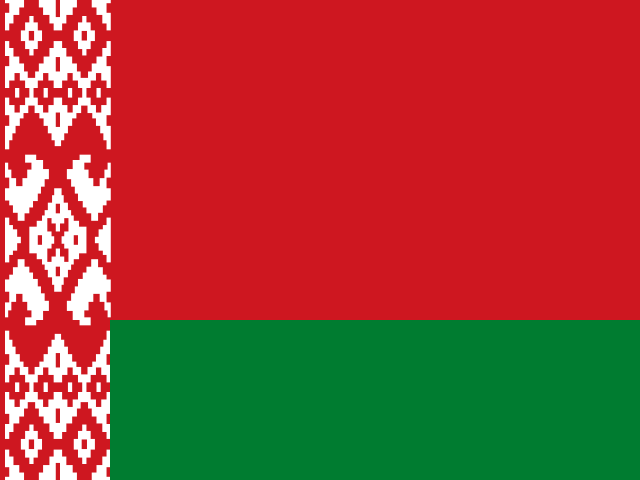 Bielorrusia | Minsk | 9.483.840 | 57.232 | 6.035 | 6,1 | 7,7 | 36,8 | 84,4 % |
|  Birmania | Naipyidó | 49.024.400 | 49.541 | 1.011 | 0,7 | 7,7 | 54,4 | 79,7 % |
| 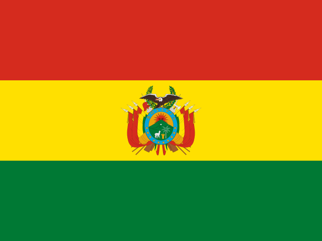 Bolivia | La Paz | 10.182.300 | 19.650 | 1.930 | 2,6 | 2,5 | 32,8 | 84,4 % |
| 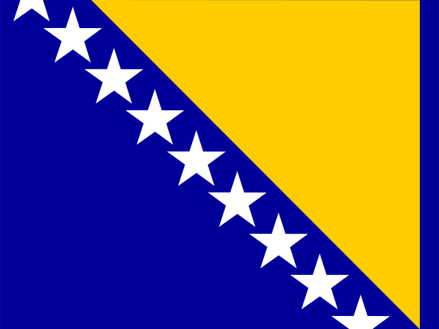 Bosnia y Herzegovina | Sarajevo | 3.811.470 | 17.176 | 4.506 | 27,3 | 2,0 | 42,2 | 75,0 % |
| 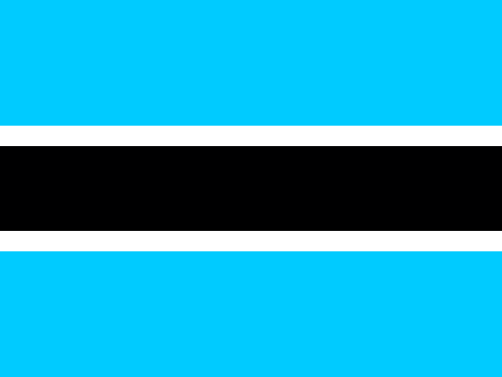 Botsuana | Gaborone | 2.033.110 | 12.637 | 6.216 | 17,9 | 6,9 | 26,5 | 82,8 % |
|  Brasil | Brasilia | 193.702.000 | 2.208.840 | 11.403 | 8,4 | 5,0 | 62,4 | 82,8 % |
| 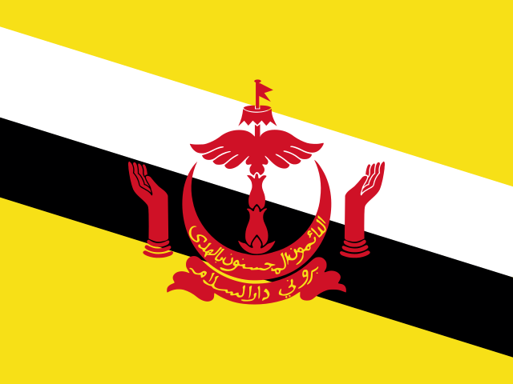 Brunéi | Bandar Seri Begawan | 392.332 | 13.707 | 34.938 | 6,5 | 0,4 | 1,1 | 84,4 % |
| 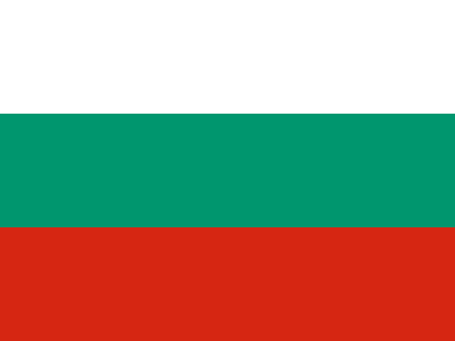 Bulgaria | Sofía | 7.395.600 | 50.692 | 6.854 | 10,3 | 2,4 | 14,1 | 84,4 % |
| 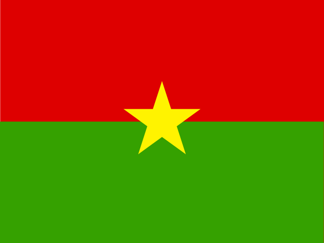 Burkina Faso | Uagadugú | 16.176.500 | 10.110 | 625 | 3,7 | -0,8 | 23,7 | 84,4 % |
| 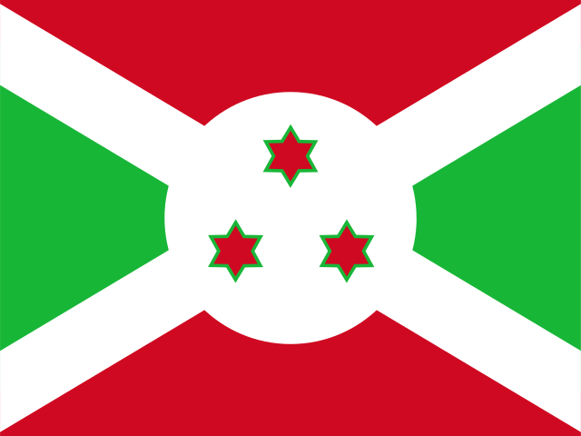 Burundi | Buyumbura | 9.376.440 | 2.032 | 217 | 1,6 | 6,5 | 46,9 | 82,8 % |
| 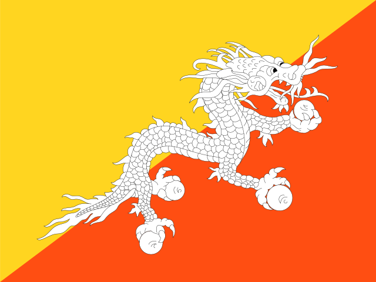 Bután | Timbu | 701.632 | 1.709 | 2.436 | 3,3 | 7,0 | 55,8 | 81,3 % |
| 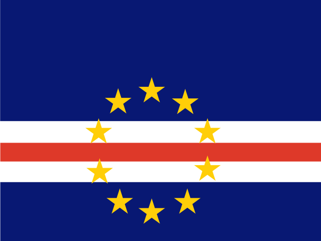 Cabo Verde | Praia | 509.784 | 1.825 | 3.579 | 10,7 | 2,1 | 61,2 | 84,4 % |
| 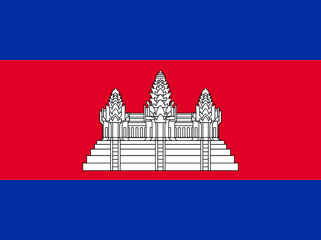 Camboya | Nom Pen | 14.500.700 | 13.809 | 952 | 0,8 | 4,0 | 23,5 | 78,1 % |
| 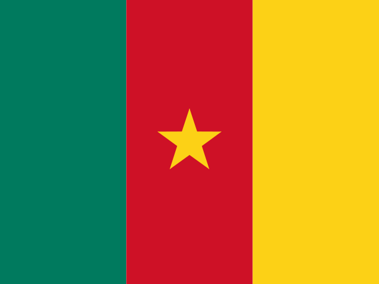 Camerún | Yaundé | 19.668.100 | 27.508 | 1.399 | 4,1 | 1,3 | 14,0 | 84,4 % |
| 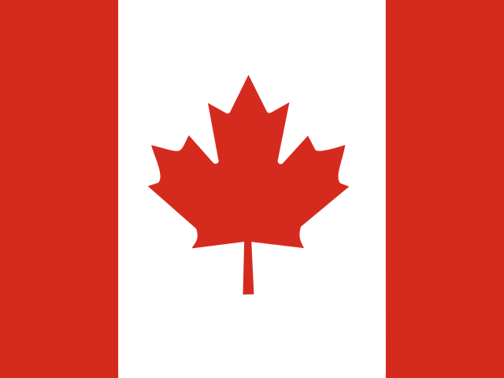 Canadá | Ottawa | 34.005.900 | 1.617.350 | 47.561 | 8,2 | 1,8 | 84,0 | 81,3 % |
| 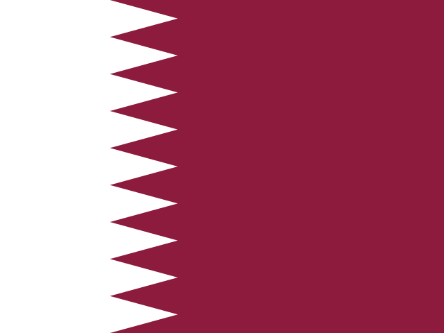 Catar | Doha | 1.616.830 | 125.122 | 77.387 | 0,5 | -2,4 | 30,4 | 84,4 % |
| 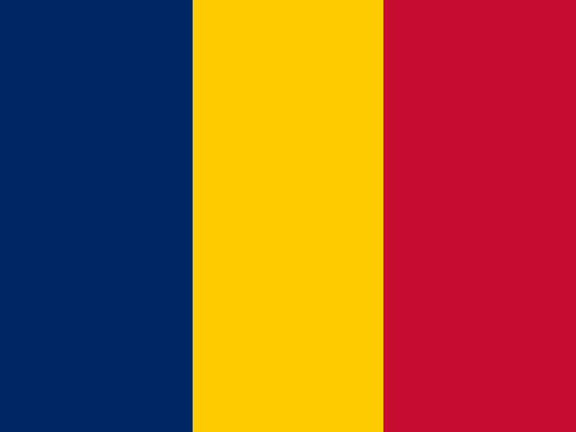 Chad | Yamena | 12.312.600 | 14.059 | 1.142 | 0,9 | -2,1 | 22,9 | 82,8 % |
| 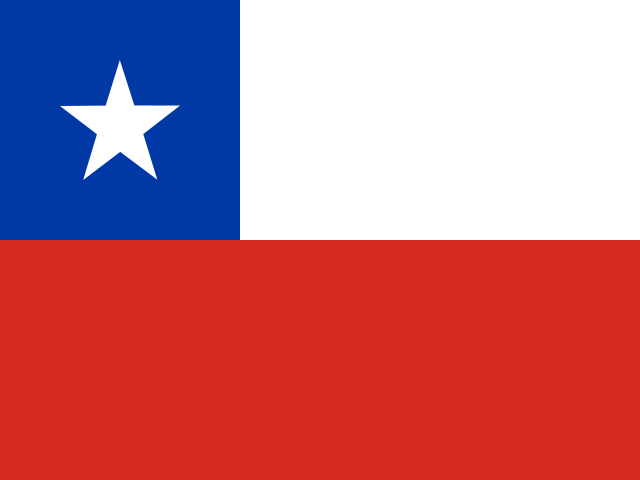 Chile | Santiago de Chile | 17.181.500 | 217.051 | 12.633 | 8,5 | 1,4 | 8,6 | 84,4 % |
|  China | Pekín | 1.337.710.000 | 6.192.560 | 4.629 | 4,5 | 3,2 | 33,1 | 81,3 % |
| 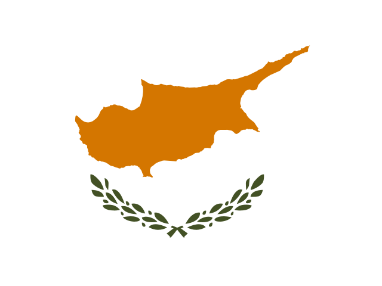 Chipre | Nicosia | 1.127.820 | 25.800 | 22.876 | 6,4 | 2,4 | 55,3 | 84,4 % |
| 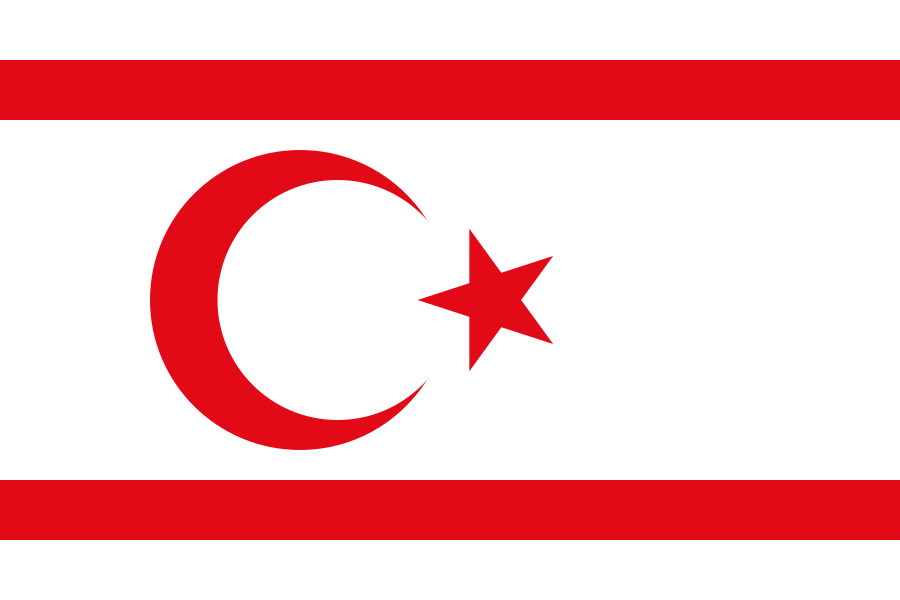 Chipre del Norte † | Nicosia Norte | 287.856 | 1.922 \* | 6.679 \* | 11,9 \* | 5,7 \* | 36,8 \* | 1,6 % |
| 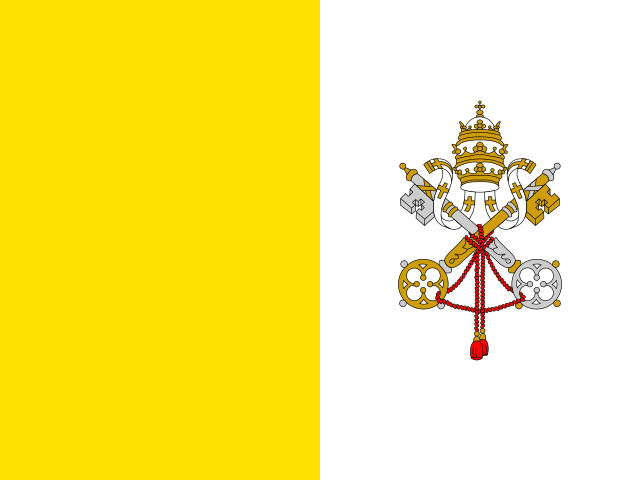 Ciudad del Vaticano | Ciudad del Vaticano | 466 | 20 \* | 42.397 \* | 8,1 \* | 1,7 \* | 55,3 \* | 14,1 % |
| 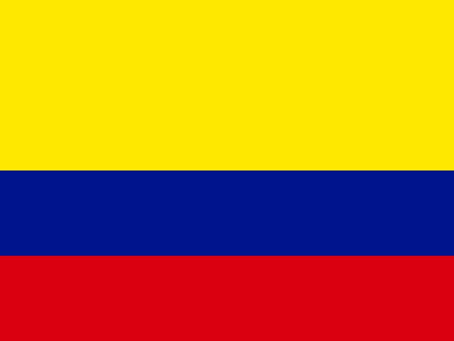 Colombia | Bogotá | 44.777.300 | 286.499 | 6.398 | 11,2 | 2,3 | 36,5 | 84,4 % |
| 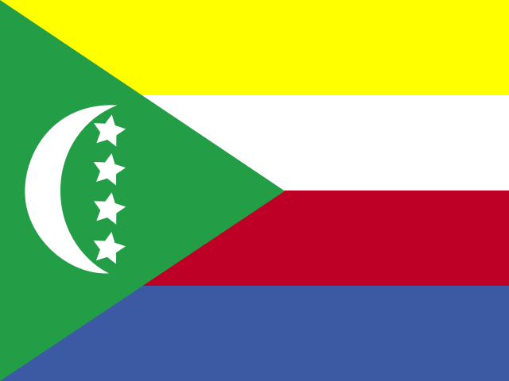 Comoras | Moroni | 654.836 | 908 | 1.387 | 4,2 | 3,4 | 30,1 | 79,7 % |
| 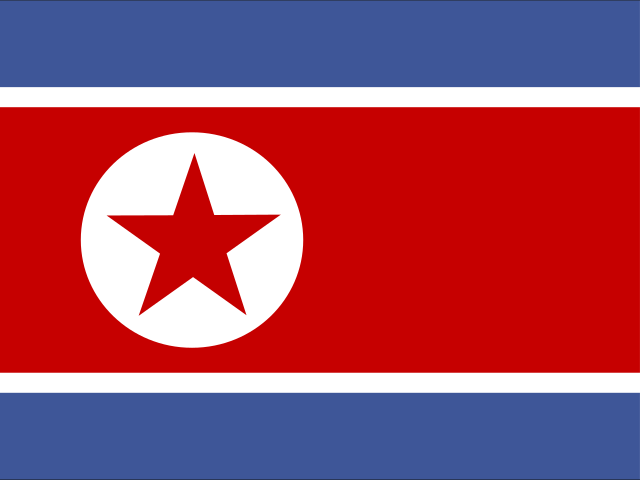 Corea del Norte | Pionyang | 24.987.300 | 25.251 \* | 1.011 \* | 3,4 | 6,0 \* | 49,3 \* | 60,9 % |
|  Corea del Sur | Seúl | 49.554.100 | 1.192.830 | 24.071 | 3,3 | 2,9 | 29,6 \* | 76,6 % |
| 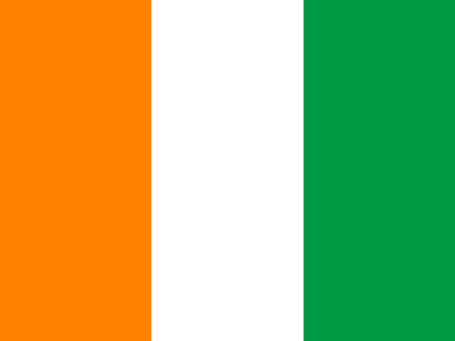 Costa de Marfil | Yamusukro | 22.488.100 | 34.936 | 1.554 | 6,6 | 1,2 | 45,6 | 82,8 % |
| 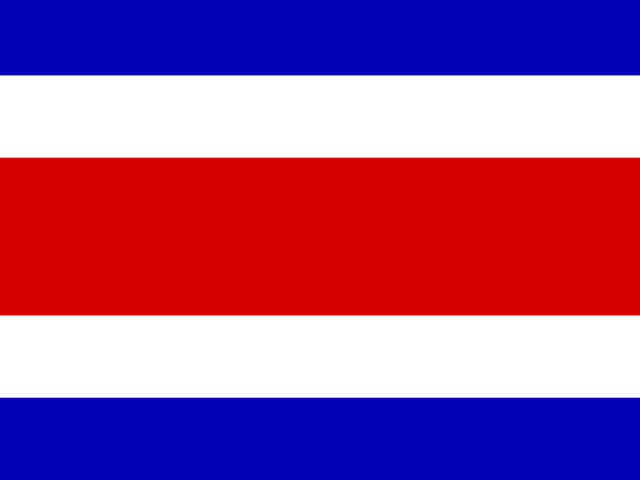 Costa Rica | San José | 4.555.960 | 37.659 | 8.266 | 7,2 | 5,7 | 28,1 | 84,4 % |
| 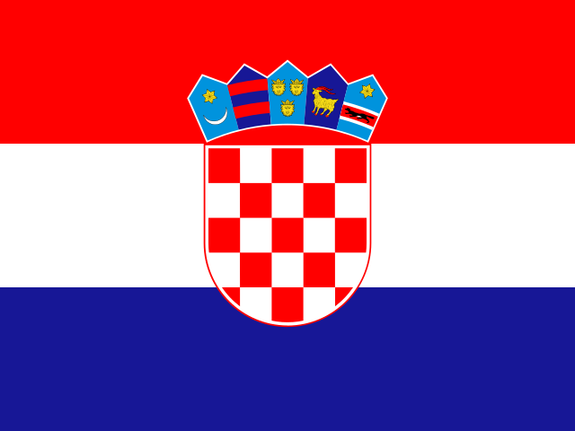 Croacia | Zagreb | 4.295.430 | 58.975 | 13.730 | 11,6 | 1,0 | 56,8 | 82,8 % |
| 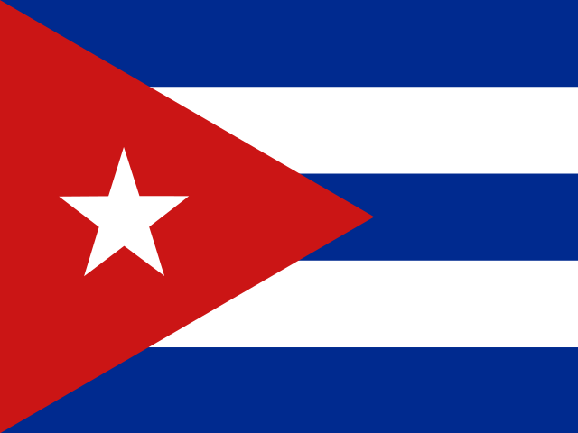 Cuba | La Habana | 11.297.400 | 59.563 | 5.272 | 2,5 | 4,2 \* | 40,6 \* | 78,1 % |
| 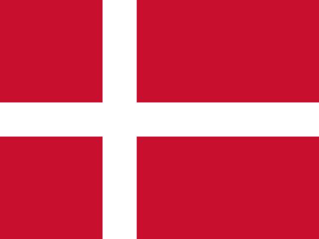 Dinamarca | Copenhague | 5.547.680 | 322.346 | 58.105 | 7,7 | 2,3 | 46,1 | 82,8 % |
|  Dominica | Roseau | 68.859 | 520 | 7.550 | 7,2 \* | 3,0 | 66,8 | 76,6 % |
|  Ecuador | Quito | 15.076.700 | 68.151 | 4.520 | 4,1 | 3,6 | 18,4 | 84,4 % |
|  Egipto | El Cairo | 89.196.100 | 218.984 | 2.455 | 8,8 | 11,3 | 69,6 | 82,8 % |
|  El Salvador | San Salvador | 6.068.250 | 18.448 | 3.040 | 4,9 | 1,2 | 66,8 | 78,1 % |
|  Emiratos Árabes Unidos | Abu Dhabi | 6.869.840 | 307.736 | 44.795 | 2,8 | 0,9 | 18,3 | 79,7 % |
|  Eritrea | Asmara | 2.945.190 | 1.590 | 540 | 5,9 | 10,3 | 201,8 | 81,3 % |
|  Eslovaquia | Bratislava | 5.391.430 | 91.112 | 16.899 | 14,4 | 1,0 | 40,7 | 82,8 % |
|  Eslovenia | Liubliana | 2.048.580 | 47.793 | 23.330 | 7,2 | 1,8 | 38,6 | 81,3 % |
|  España | Madrid | 46.576.900 | 1.427.990 | 30.659 | 19,9 | 1,8 | 60,3 | 84,4 % |
|  Estados Unidos | Washington D. C. | 309.378.000 | 15.049.000 | 48.643 | 9,6 | 1,6 | 95,7 | 81,3 % |
|  Estonia | Tallin | 1.331.480 | 19.524 | 14.664 | 16,7 | 3,0 | 8,0 | 84,4 % |
|  Etiopía | Adís Abeba | 90.538.500 | 29.934 | 331 | 2,3 | 8,1 | 39,4 | 82,8 % |
|  Filipinas | Manila | 96.337.100 | 208.369 | 2.163 | 3,6 | 3,8 | 47,6 | 84,4 % |
|  Finlandia | Helsinki | 5.363.350 | 249.430 | 46.506 | 8,4 | 1,2 | 50,1 | 82,8 % |
|  Fiyi | Suva | 910.419 | 3.140 | 3.449 | 4,3 | 3,7 | 53,4 | 82,8 % |
|  Francia | París | 65.026.200 | 2.646.230 | 40.695 | 9,3 | 1,5 | 86,3 | 81,3 % |
|  Gabón | Libreville | 1.719.880 | 14.373 | 8.357 | 20,4 | 1,5 | 21,3 | 82,8 % |
|  Gambia | Banjul | 1.926.630 | 1.543 | 801 | 9,7 | 5,0 | 42,9 | 82,8 % |
|  Georgia | Tiflis | 3.786.700 | 12.427 | 3.282 | 20,2 | 7,1 | 31,4 | 82,8 % |
|  Ghana | Acra | 25.475.000 | 32.198 | 1.264 | 5,4 | 10,7 | 32,9 | 84,4 % |
|  Gibraltar ‡ | Gibraltar | 31.248 | 1.325 \* | 42.397 \* | 8,1 \* | 1,7 \* | 55,3 \* | 50,0 % |
|  Granada | Saint George | 111.586 | 771 | 6.910 | 7,2 \* | 3,4 | 96,2 | 75,0 % |
|  Grecia | Atenas | 11.121.300 | 296.418 | 26.653 | 12,7 | 4,7 | 147,8 | 84,4 % |
|  Groenlandia ‡ | Nuuk | 56.534 | 2.503 | 44.277 | 8,1 \* | 1,7 \* | 55,3 \* | 67,2 % |
|  Guam ‡ | Agaña | 166.522 | 4.949 | 29.720 | 8,2 | 2,6 \* | 29,6 \* | 59,4 % |
|  Guatemala | Ciudad de Guatemala | 14.500.100 | 40.677 | 2.805 | 3,5 | 3,9 | 24,0 | 84,4 % |
|  Guinea | Conakri | 10.396.100 | 6.853 | 659 | 5,0 | 15,1 | 51,9 | 82,8 % |
|  Guinea Ecuatorial | Malabo | 1.189.090 | 16.314 | 13.720 | 7,8 | 7,8 | 7,9 | 81,3 % |
|  Guinea-Bisáu | Bisáu | 1.566.350 | 940 | 600 | 3,1 | 2,5 | 61,7 | 82,8 % |
|  Guyana | Georgetown | 749.256 | 3.433 | 4.582 | 11,6 | 4,3 | 53,1 | 81,3 % |
|  Haití | Puerto Príncipe | 9.803.290 | 11.859 | 1.210 | 15,2 | 4,8 | 24,9 | 81,3 % |
|  Honduras | Tegucigalpa | 8.365.880 | 15.839 | 1.893 | 4,1 | 4,7 | 23,4 | 84,4 % |
|  Hong Kong ‡ | Hong Kong | 7.024.200 | 228.639 | 32.550 | 4,3 | 2,3 | 0,6 | 78,1 % |
|  Hungría | Budapest | 10.000.000 | 131.899 | 13.190 | 11,2 | 4,9 | 80,2 | 82,8 % |
|  India | Nueva Delhi | 1.243.480.000 | 1.675.620 | 1.348 | 7,6 | 12,0 | 67,7 | 82,8 % |
|  Indonesia | Yakarta | 246.305.000 | 755.094 | 3.066 | 5,6 | 5,1 | 26,4 | 84,4 % |
|  Irak | Bagdad | 31.045.400 | 138.517 | 4.462 | 8,3 | 2,4 | 53,5 | 82,8 % |
|  Irán | Teherán | 77.420.800 | 487.070 | 6.291 | 13,7 | 10,1 | 12,8 | 82,8 % |
|  Irlanda | Dublín | 4.560.160 | 221.733 | 48.624 | 14,5 | -0,9 | 86,3 | 82,8 % |
|  Isla de Man ‡ | Douglas | 83.873 | 5.920 | 70.587 | 8,1 \* | 1,7 \* | 55,3 \* | 25,0 % |
|  Islandia | Reikiavik | 318.041 | 13.923 | 43.777 | 7,6 | 5,4 | 131,5 | 82,8 % |
|  Islas Caimán ‡ | George Town | 54.099 | 4.157 | 76.838 | 10,7 \* | 0,3 | 79,4 \* | 64,1 % |
|  Islas del Canal ‡ | Saint Helier y Saint Peter Port | 158.621 | 8.902 | 56.124 | 7,0 | 1,7 \* | 55,3 \* | 23,4 % |
|  Islas Feroe ‡ | Tórshavn | 48.656 | 2.332 | 47.924 | 8,1 \* | 1,7 \* | 55,3 \* | 67,2 % |
|  Islas Marianas del Norte ‡ | Saipan | 54.091 | 799 | 14.771 | 5,2 \* | 2,6 \* | 29,6 \* | 32,8 % |
|  Islas Marshall | Majuro | 52.044 | 161 | 3.095 | 3,6 \* | 4,7 | 38,8 | 46,9 % |
|  Islas Salomón | Honiara | 532.968 | 898 | 1.685 | 1,6 | 1,1 | 21,6 | 79,7 % |
|  Islas Turcas y Caicos ‡ | Cockburn Town | 29.739 | 687 | 23.094 | 10,7 \* | 3,4 \* | 79,4 \* | 67,2 % |
|  Islas Vírgenes Británicas ‡ | Road Town | 27.675 | 465 \* | 16.815 \* | 10,7 \* | 3,4 \* | 79,4 \* | 59,4 % |
|  Islas Vírgenes de EE. UU. ‡ | Charlotte Amalie | 108.357 | 4.324 | 39.905 | 11,1 | 3,4 \* | 79,4 \* | 59,4 % |
|  Israel | Jerusalén | 7.623.600 | 239.373 | 31.399 | 8,5 | 2,7 | 69,4 | 82,8 % |
|  Italia | Roma | 59.819.400 | 2.144.940 | 35.857 | 8,4 | 1,5 | 118,8 | 84,4 % |
|  Jamaica | Kingston | 2.748.570 | 13.221 | 4.810 | 7,6 | 12,6 | 137,8 | 81,3 % |
|  Japón | Tokio | 128.070.000 | 5.811.580 | 45.378 | 5,1 | -0,7 | 178,6 | 81,3 % |
|  Jordania | Amán | 7.297.040 | 30.203 | 4.139 | 12,5 | 4,8 | 53,4 | 82,8 % |
|  Kazajistán | Astaná | 16.836.800 | 148.047 | 8.793 | 5,8 | 7,4 | 10,7 | 82,8 % |
|  Kenia | Nairobi | 41.598.600 | 45.406 | 1.092 | 2,8 | 4,0 | 36,7 | 82,8 % |
|  Kirguistán | Biskek | 5.467.060 | 4.794 | 877 | 3,5 | 8,0 | 59,7 | 84,4 % |
|  Kiribati | Tarawa Sur | 108.704 | 165 | 1.522 | 3,6 \* | -3,9 | 9,4 | 78,1 % |
|  Kosovo † | Pristina | 1.788.740 | 5.344 | 2.988 | 6,7 \* | 3,5 | 6,5 | 68,8 % |
|  Kuwait | Ciudad de Kuwait | 2.943.370 | 115.416 | 39.212 | 1,8 | 4,5 | 6,2 | 84,4 % |
|  Laos | Vientián | 6.334.190 | 7.132 | 1.126 | 0,7 | 6,0 | 49,3 | 84,4 % |
|  Lesoto | Maseru | 1.996.250 | 2.235 | 1.119 | 16,1 | -2,4 | 33,8 | 84,4 % |
|  Letonia | Riga | 2.097.560 | 23.468 | 11.188 | 19,5 | -1,1 | 48,2 | 84,4 % |
|  Líbano | Beirut | 5.041.290 | 38.444 | 7.626 | 6,8 | 4,0 | 136,8 | 84,4 % |
|  Liberia | Monrovia | 4.058.890 | 1.998 | 492 | 2,3 | 7,3 | 25,4 | 82,8 % |
|  Libia | Trípoli | 6.497.840 | 75.381 | 11.601 | 19,3 | 2,8 | 12,0 | 81,3 % |
|  Liechtenstein | Vaduz | 36.022 | 5.082 | 141.090 | 2,6 | 0,7 | 55,3 \* | 37,5 % |
|  Lituania | Vilna | 3.097.280 | 36.638 | 11.829 | 17,8 | 1,3 | 36,7 | 84,4 % |
|  Luxemburgo | Luxemburgo | 506.953 | 56.214 | 110.886 | 4,4 | 2,3 | 19,1 | 82,8 % |
|  Macao ‡ | Macao | 537.000 | 28.244 | 52.596 | 2,8 | 2,8 | 0,0 | 78,1 % |
|  Macedonia | Skopie | 1.946.300 | 9.407 | 4.833 | 33,1 | 1,5 | 24,3 | 79,7 % |
|  Madagascar | Antananarivo | 22.183.300 | 9.983 | 450 | 4,3 | 9,2 | 32,3 | 84,4 % |
|  Malasia | Kuala Lumpur | 28.655.800 | 255.018 | 8.899 | 3,3 | 1,6 | 51,2 | 82,8 % |
|  Malaui | Lilongüe | 14.826.500 | 10.128 | 683 | 4,8 | 7,4 | 19,3 | 81,3 % |
|  Maldivas | Malé | 360.792 | 2.588 | 7.174 | 10,9 | 6,1 | 52,7 | 79,7 % |
|  Mali | Bamako | 15.945.200 | 12.711 | 797 | 1,4 | 1,1 | 21,8 | 84,4 % |
|  Malta | La Valeta | 414.508 | 9.097 | 21.947 | 6,9 | 1,5 | 65,0 | 82,8 % |
|  Marruecos | Rabat | 32.467.000 | 100.865 | 3.107 | 9,1 | 1,0 | 45,3 | 84,4 % |
|  Mauricio | Port Louis | 1.250.400 | 10.145 | 8.113 | 7,7 | 2,9 | 54,4 | 84,4 % |
|  Mauritania | Nuakchot | 3.390.970 | 5.629 | 1.660 | 10,1 | 6,3 | 43,9 | 82,8 % |
|  México | Ciudad de México | 113.624.000 | 1.105.420 | 9.729 | 5,3 | 4,2 | 40,2 | 82,8 % |
|  Micronesia | Palikir | 107.540 | 292 | 2.715 | 3,6 \* | 3,3 | 29,4 | 50,0 % |
|  Moldavia | Chisináu | 2.862.350 | 6.975 | 2.437 | 3,0 | 7,5 | 25,5 | 82,8 % |
|  Mónaco | Mónaco | 33.163 | 5.368 | 161.854 | 8,1 \* | 1,7 \* | 55,3 \* | 32,8 % |
|  Mongolia | Ulán Bator | 2.738.620 | 7.189 | 2.625 | 6,5 | 10,0 | 31,0 | 82,8 % |
|  Montenegro | Podgorica | 619.428 | 4.137 | 6.679 | 19,6 | 0,7 | 42,0 | 79,7 % |
|  Mozambique | Maputo | 22.999.200 | 11.412 | 496 | 3,3 | 12,4 | 38,6 | 84,4 % |
|  Namibia | Windhoek | 2.109.810 | 11.431 | 5.418 | 22,1 | 4,9 | 16,3 | 84,4 % |
|  Nauru | Yaren | 10.043 | 48 | 4.736 | 3,3 \* | -2,0 | 298,9 | 71,9 % |
|  Nepal | Katmandú | 27.342.000 | 16.003 | 585 | 10,6 | 9,3 | 35,4 | 84,4 % |
|  Nicaragua | Managua | 5.737.450 | 8.759 | 1.527 | 7,8 | 5,5 | 30,3 | 84,4 % |
|  Níger | Niamey | 16.548.800 | 7.851 | 474 | 0,7 | 0,8 | 15,1 | 84,4 % |
|  Nigeria | Abuya | 166.643.000 | 366.990 | 2.202 | 3,7 | 13,7 | 6,7 | 82,8 % |
|  Noruega | Oslo | 4.889.250 | 440.132 | 90.020 | 3,5 | 2,4 | 42,1 | 82,8 % |
|  Nueva Caledonia ‡ | Numea | 261.582 | 9.364 | 35.799 | 14,0 | 2,6 \* | 29,6 \* | 67,2 % |
|  Nueva Zelanda | Wellington | 4.350.700 | 146.888 | 33.762 | 6,6 | 2,3 | 29,6 | 81,3 % |
|  Omán | Mascate | 2.757.450 | 64.994 | 23.570 | 3,9 | 3,3 | 5,5 | 84,4 % |
|  Osetia del Sur † | Tsjinval | 54.415 \* | 165 \* | 3.040 \* | 6,7 \* | 7,8 \* | 28,5 \* | 0,0 % |
|  Países Bajos | Ámsterdam | 16.615.400 | 852.465 | 51.306 | 5,0 | 1,3 | 58,9 | 82,8 % |
|  Pakistán | Islamabad | 199.239.000 | 196.710 | 987 | 0,7 | 12,9 | 56,7 | 84,4 % |
|  Palaos | Ngerulmud | 18.396 | 184 | 10.018 | 3,3 \* | 1,4 | 29,5 | 45,3 % |
|  Palestina † | Ramala | 3.786.160 | 9.682 | 2.557 | 21,4 | 3,7 | 22,7 | 81,3 % |
|  Panamá | Ciudad de Panamá | 3.628.540 | 30.231 | 8.331 | 5,8 | 3,5 | 38,5 | 84,4 % |
|  Papúa Nueva Guinea | Puerto Moresby | 7.633.520 | 14.251 | 1.867 | 2,0 | 6,0 | 17,3 | 81,3 % |
|  Paraguay | Asunción | 5.737.970 | 27.261 | 4.751 | 4,6 | 4,7 | 13,0 | 84,4 % |
|  Perú | Lima | 29.086.000 | 147.528 | 5.072 | 3,6 | 1,5 | 25,1 | 84,4 % |
|  Polinesia Francesa ‡ | Papeete | 270.580 | 6.087 | 22.495 | 12,1 | 2,6 \* | 29,6 \* | 68,8 % |
|  Polonia | Varsovia | 38.042.800 | 478.112 | 12.568 | 9,6 | 2,6 | 53,7 | 82,8 % |
|  Portugal | Lisboa | 10.573.100 | 238.444 | 22.552 | 10,8 | 1,4 | 99,9 | 84,4 % |
|  Puerto Rico ‡ | San Juan | 3.724.470 | 98.381 | 26.415 | 16,1 | 2,5 | 48,3 | 68,8 % |
|  Reino Unido | Londres | 62.766.400 | 2.496.740 | 39.778 | 8,0 | 2,5 | 75,5 | 82,8 % |
|  República Centroafricana | Bangui | 4.493.000 | 2.143 | 477 | 5,7 | 1,5 | 13,6 | 82,8 % |
|  República Checa | Praga | 10.474.400 | 211.169 | 20.160 | 7,3 | 1,5 | 36,7 | 82,8 % |
|  República del Congo | Brazzaville | 4.462.290 | 13.148 | 2.947 | 19,3 | 0,4 | 43,5 | 84,4 % |
|  República Democrática del Congo | Kinsasa | 68.563.000 | 24.162 | 352 | 4,1 | 7,1 | 31,8 | 84,4 % |
|  República Dominicana | Santo Domingo | 9.820.180 | 53.801 | 5.479 | 5,2 | 6,3 | 37,4 | 84,4 % |
|  Ruanda | Kigali | 10.317.600 | 6.052 | 587 | 11,6 | -0,2 | 19,0 | 84,4 % |
|  Rumanía | Bucarest | 20.246.900 | 170.064 | 8.400 | 7,0 | 6,1 | 30,2 | 84,4 % |
|  Rusia | Moscú | 142.849.000 | 1.524.920 | 10.675 | 7,4 | 6,8 | 10,1 | 82,8 % |
|  Sáhara Occidental † | El Aaiún | 409.722 | 1.062 \* | 2.593 \* | 10,8 \* | 4,6 \* | 45,3 \* | 43,8 % |
|  Samoa | Apia | 193.023 | 680 | 3.524 | 5,6 | 0,8 | 40,3 | 81,3 % |
|  Samoa Americana ‡ | Pago Pago | 55.228 | 573 | 10.375 | 3,3 \* | 1,5 \* | 36,5 \* | 56,3 % |
|  San Cristóbal y Nieves | Basseterre | 46.846 | 779 | 16.623 | 10,7 \* | 0,9 | 134,9 | 75,0 % |
|  San Marino | San Marino | 33.270 | 1.881 | 56.543 | 4,9 | 2,6 | 20,0 | 35,9 % |
|  San Martín (Francia) ‡ | Marigot | 36.856 | 620 \* | 16.815 \* | 10,7 \* | 3,4 \* | 79,4 \* | 20,3 % |
|  San Vicente y las Granadinas | Kingstown | 109.959 | 720 | 6.552 | 19,9 | 0,7 | 61,1 | 76,6 % |
|  Santa Lucía | Castries | 170.906 | 1.482 | 8.674 | 17,1 | 3,3 | 52,3 | 78,1 % |
|  Santo Tomé y Príncipe | Santo Tomé | 181.802 | 190 | 1.045 | 14,6 | 13,3 | 83,0 | 81,3 % |
|  Senegal | Dakar | 12.635.400 | 16.121 | 1.276 | 2,8 | 1,2 | 34,6 | 84,4 % |
|  Serbia | Belgrado | 7.291.440 | 43.537 | 5.971 | 19,2 | 6,1 | 42,4 | 82,8 % |
|  Seychelles | Victoria | 89.770 | 982 | 10.935 | 4,6 | -2,4 | 82,2 | 84,4 % |
|  Sierra Leona | Freetown | 6.222.710 | 4.263 | 685 | 4,3 | 7,2 | 28,9 | 82,8 % |
|  Singapur | Singapur | 5.076.730 | 239.808 | 47.237 | 4,1 | 2,8 | 98,7 | 79,7 % |
|  Siria | Damasco | 22.482.400 | 61.391 | 2.731 | 8,6 | 4,4 | 30,0 | 82,8 % |
|  Somalia | Mogadiscio | 12.261.800 | 2.688 | 219 | 18,7 | 5,6 \* | 32,1 \* | 65,6 % |
|  Somalilandia † | Hargeisa | 4.192.790 \* | 2.516 \* | 600 \* | 3,7 \* | 5,6 \* | 32,1 \* | 0,0 % |
|  Sri Lanka | Colombo | 20.879.100 | 58.636 | 2.808 | 4,8 | 6,2 | 68,7 | 79,7 % |
|  Suazilandia | Mbabane | 1.111.650 | 4.361 | 3.923 | 26,9 | 4,5 | 14,2 | 79,7 % |
|  Sudáfrica | Pretoria | 52.344.100 | 417.364 | 7.973 | 24,7 | 4,1 | 31,2 | 82,8 % |
|  Sudán | Jartum | 45.160.400 | 73.565 | 1.629 | 14,6 | 10,6 | 74,6 | 82,8 % |
|  Suecia | Estocolmo | 9.378.130 | 492.751 | 52.543 | 8,6 | 1,2 | 38,7 | 82,8 % |
|  Suiza | Berna | 7.824.910 | 610.000 | 77.956 | 4,8 | 0,7 | 42,6 | 82,8 % |
|  Surinam | Paramaribo | 549.923 | 4.368 | 7.944 | 7,2 | 6,9 | 17,3 | 81,3 % |
|  Tailandia | Bangkok | 68.579.400 | 341.105 | 4.974 | 0,6 | 3,2 | 39,8 | 82,8 % |
|  Taiwán † | Taipéi | 23.162.000 | 444.281 | 19.182 | 5,2 | 1,0 | 36,9 | 60,9 % |
|  Tanzania | Dodoma | 44.758.500 | 32.013 | 715 | 3,0 | 6,2 | 27,6 | 84,4 % |
|  Tayikistán | Dusambé | 7.652.140 | 5.642 | 737 | 7,0 | 6,4 | 36,8 | 84,4 % |
|  Timor Oriental | Dili | 1.084.680 | 882 | 813 | 3,3 | 6,8 | 0,0 | 84,4 % |
|  Togo | Lomé | 6.325.790 | 4.746 | 750 | 2,4 | 1,4 | 33,5 | 84,4 % |
|  Tonga | Nukualofa | 107.400 | 367 | 3.416 | 1,5 | 3,5 | 44,7 | 79,7 % |
|  Transnistria † | Tiráspol | 505.955 \* | 1.538 \* | 3.040 \* | 6,7 \* | 7,8 \* | 28,5 \* | 0,0 % |
|  Trinidad y Tobago | Puerto España | 1.317.710 | 22.158 | 16.815 | 4,0 | 10,5 | 28,9 | 81,3 % |
|  Túnez | Túnez | 10.766.000 | 46.206 | 4.292 | 13,0 | 3,3 | 38,8 | 84,4 % |
|  Turkmenistán | Asjabad | 5.564.360 | 22.583 | 4.059 | 4,0 | 4,4 | 7,0 | 81,3 % |
|  Turquía | Ankara | 73.142.200 | 782.546 | 10.699 | 11,9 | 8,6 | 38,6 | 84,4 % |
|  Tuvalu | Funafuti | 10.614 | 32 | 3.055 | 3,3 \* | -1,9 | 21,1 | 45,3 % |
|  Ucrania | Kiev | 46.456.000 | 141.209 | 3.040 | 8,1 | 9,4 | 39,1 | 82,8 % |
|  Uganda | Kampala | 32.390.800 | 26.673 | 823 | 3,6 | 4,0 | 18,4 | 84,4 % |
|  Uruguay | Montevideo | 3.318.580 | 41.950 | 12.641 | 7,2 | 6,7 | 40,9 | 82,8 % |
|  Uzbekistán | Taskent | 28.385.500 | 55.544 | 1.957 | 5,4 | 12,3 | 5,9 | 79,7 % |
|  Vanuatu | Port Vila | 238.248 | 671 | 2.815 | 4,7 | 2,8 | 18,3 | 79,7 % |
|  Venezuela | Caracas | 28.813.100 | 393.192 | 13.646 | 7,1 | 28,2 | 40,6 \* | 76,6 % |
|  Vietnam | Hanói | 87.455.200 | 147.201 | 1.683 | 1,1 | 9,2 | 37,3 | 82,8 % |
|  Yemen | Saná | 26.754.400 | 30.907 | 1.155 | 12,8 | 11,2 | 45,3 \* | 78,1 % |
|  Yibuti | Ciudad de Yibuti | 930.251 | 1.129 | 1.213 | 26,4 | 4,0 | 27,9 | 76,6 % |
|  Zambia | Lusaka | 13.965.600 | 20.266 | 1.451 | 13,2 | 8,5 | 18,9 | 84,4 % |
|  Zimbabue | Harare | 13.356.500 | 12.048 | 902 | 5,5 | 3,0 | 33,2 | 82,8 % |

## Cobertura por campo

Cuántos de los 223 países y territorios tienen cada dato.

| Campo | Unidad | Real | Estimado | Sin dato | Fuentes de los reales |
| --- | --- | --: | --: | --: | --- |
| Población | habitantes | 219 | 4 | 0 | BM 215, WD 2, OWID 1, FMI 1 |
| Superficie terrestre | km² | 213 | 9 | 1 | OWID 213 |
| PIB | US$ corrientes | 212 | 11 | 0 | BM 211, FMI 1 |
| Crecimiento del PIB real | % anual | 211 | 12 | 0 | BM 209, FMI 2 |
| Agricultura, silvicultura y pesca | % del PIB | 196 | 27 | 0 | BM 196 |
| Industria y construcción | % del PIB | 198 | 25 | 0 | BM 198 |
| Servicios | % del PIB | 196 | 27 | 0 | BM 196 |
| Paro | % de la población activa | 192 | 31 | 0 | BM 186, FMI 6 |
| Inflación | % anual | 197 | 26 | 0 | BM 186, FMI 11 |
| Comercio exterior (exportaciones más importaciones) | % del PIB | 179 | 44 | 0 | BM 179 |
| Balanza por cuenta corriente | % del PIB | 185 | 38 | 0 | FMI 185 |
| Deuda pública | % del PIB | 191 | 32 | 0 | FMI 191 |
| Saldo fiscal (superávit o déficit público) | % del PIB | 191 | 32 | 0 | FMI 191 |
| Gasto en sanidad | % del PIB | 188 | 35 | 0 | BM 188 |
| Gasto público en educación | % del PIB | 178 | 45 | 0 | BM 178 |
| Gasto militar | % del PIB | 158 | 65 | 0 | BM 158 |
| Personal de las fuerzas armadas | personas | 169 | 54 | 0 | BM 169 |
| Esperanza de vida al nacer | años | 215 | 8 | 0 | BM 215 |
| Alfabetización de adultos | % | 115 | 108 | 0 | BM 115 |
| Acceso a la electricidad | % de la población | 213 | 10 | 0 | BM 213 |
| Usuarios de internet | % de la población | 203 | 20 | 0 | BM 203 |
| Generación eléctrica | TWh | 204 | 19 | 0 | OWID 204 |
| Demanda eléctrica | TWh | 204 | 19 | 0 | OWID 204 |
| Importaciones netas de electricidad | TWh | 204 | 19 | 0 | OWID 204 |
| Electricidad de carbón | TWh | 202 | 21 | 0 | OWID 202 |
| Electricidad de gas | TWh | 201 | 22 | 0 | OWID 201 |
| Electricidad de petróleo y fuel | TWh | 204 | 19 | 0 | OWID 204 |
| Electricidad nuclear | TWh | 201 | 22 | 0 | OWID 201 |
| Electricidad hidráulica | TWh | 201 | 22 | 0 | OWID 201 |
| Electricidad eólica | TWh | 195 | 28 | 0 | OWID 195 |
| Electricidad solar | TWh | 204 | 19 | 0 | OWID 204 |
| Electricidad de biomasa | TWh | 203 | 20 | 0 | OWID 203 |
| Electricidad de otras renovables | TWh | 180 | 43 | 0 | OWID 180 |
| Consumo de energía primaria | TWh | 206 | 17 | 0 | OWID 206 |
| Producción de carbón | TWh | 205 | 18 | 0 | OWID 205 |
| Producción de petróleo | TWh | 205 | 18 | 0 | OWID 205 |
| Producción de gas natural | TWh | 205 | 18 | 0 | OWID 205 |
| Emisiones de CO₂ | millones de toneladas | 204 | 19 | 0 | OWID 204 |
| CO₂ acumulado desde 1750 | millones de toneladas | 204 | 19 | 0 | OWID 204 |
| Gases de efecto invernadero | millones de toneladas de CO₂ equivalente | 195 | 28 | 0 | OWID 195 |
| Reservas probadas de petróleo | millones de barriles | 202 | 21 | 0 | OWID 202 |
| Reservas probadas de gas natural | miles de millones de m³ | 203 | 20 | 0 | OWID 203 |
| Reservas probadas de carbón | millones de toneladas | 204 | 19 | 0 | OWID 204 |
| Producción minera de cobre | toneladas | 217 | 0 | 6 | OWID 217 |
| Producción minera de bauxita | toneladas | 217 | 0 | 6 | OWID 217 |
| Producción minera de litio | toneladas | 217 | 0 | 6 | OWID 217 |
| Producción minera de cobalto | toneladas | 217 | 0 | 6 | OWID 217 |
| Producción minera de oro | toneladas | 217 | 0 | 6 | OWID 217 |
| Producción minera de plata | toneladas | 217 | 0 | 6 | OWID 217 |
| Producción minera de roca fosfática | toneladas | 217 | 0 | 6 | OWID 217 |
| Producción minera de uranio | toneladas | 217 | 0 | 6 | OWID 217 |
| Reservas de mineral de hierro | toneladas | 0 | 17 | 206 | — |
| Reservas de cobre | toneladas | 0 | 17 | 206 | — |
| Reservas de bauxita | toneladas | 0 | 20 | 203 | — |
| Reservas de níquel | toneladas | 0 | 9 | 214 | — |
| Reservas de litio | toneladas | 0 | 11 | 212 | — |
| Reservas de cobalto | toneladas | 0 | 13 | 210 | — |
| Reservas de tierras raras | toneladas | 0 | 13 | 210 | — |
| Reservas de oro | toneladas | 0 | 17 | 206 | — |
| Reservas de plata | toneladas | 0 | 12 | 211 | — |
| Reservas de roca fosfática | toneladas | 0 | 24 | 199 | — |
| PIB per cápita | US$ corrientes | 212 | 11 | 0 | DER 212 |
| Densidad de población | habitantes por km² | 213 | 9 | 1 | DER 213 |
| Emisiones de CO₂ por habitante | toneladas | 204 | 19 | 0 | DER 204 |

Siglas: **BM** = Banco Mundial, World Development Indicators; **FMI** = FMI, Perspectivas de la economía mundial (WEO); **OWID** = Our World in Data (Ember, Energy Institute, EIA, Global Carbon Project, USGS, BGS); **WD** = Wikidata; **DER** = Derivado de otros campos reales; **EST** = Estimación (valor de respaldo), no es un dato real. «OWID ausente» cuenta como real: la fuente solo lista productores y el país no figura (valor 0).

## Países con más estimaciones

| País | Jugable | Reales | Estimados | Sin dato | Campos estimados |
| --- | --- | --: | --: | --: | --- |
|  Abjasia † | sí | 0 | 46 | 18 | Población, Superficie terrestre, PIB, Crecimiento del PIB real, Agricultura, silvicultura y pesca, Industria y construcción, Servicios, Paro… (46) |
|  Osetia del Sur † | sí | 0 | 46 | 18 | Población, Superficie terrestre, PIB, Crecimiento del PIB real, Agricultura, silvicultura y pesca, Industria y construcción, Servicios, Paro… (46) |
|  Somalilandia † | sí | 0 | 46 | 18 | Población, Superficie terrestre, PIB, Crecimiento del PIB real, Agricultura, silvicultura y pesca, Industria y construcción, Servicios, Paro… (46) |
|  Transnistria † | sí | 0 | 46 | 18 | Población, Superficie terrestre, PIB, Crecimiento del PIB real, Agricultura, silvicultura y pesca, Industria y construcción, Servicios, Paro… (46) |
|  Chipre del Norte † | sí | 1 | 45 | 18 | Superficie terrestre, PIB, Crecimiento del PIB real, Agricultura, silvicultura y pesca, Industria y construcción, Servicios, Paro, Inflación… (45) |
|  Ciudad del Vaticano | no | 9 | 43 | 12 | PIB, Crecimiento del PIB real, Agricultura, silvicultura y pesca, Industria y construcción, Servicios, Paro, Inflación, Comercio exterior (exportaciones más importaciones)… (43) |
|  San Martín (Francia) ‡ | sí | 13 | 41 | 10 | PIB, Crecimiento del PIB real, Agricultura, silvicultura y pesca, Industria y construcción, Servicios, Paro, Inflación, Comercio exterior (exportaciones más importaciones)… (41) |
|  Islas del Canal ‡ | sí | 15 | 39 | 10 | Superficie terrestre, Agricultura, silvicultura y pesca, Industria y construcción, Servicios, Inflación, Comercio exterior (exportaciones más importaciones), Balanza por cuenta corriente, Deuda pública… (39) |
|  Isla de Man ‡ | sí | 16 | 38 | 10 | Agricultura, silvicultura y pesca, Industria y construcción, Servicios, Paro, Inflación, Comercio exterior (exportaciones más importaciones), Balanza por cuenta corriente, Deuda pública… (38) |
|  Islas Marianas del Norte ‡ | sí | 21 | 33 | 10 | Agricultura, silvicultura y pesca, Industria y construcción, Servicios, Paro, Inflación, Balanza por cuenta corriente, Deuda pública, Saldo fiscal (superávit o déficit público)… (33) |
|  Mónaco | sí | 21 | 33 | 10 | Agricultura, silvicultura y pesca, Paro, Inflación, Comercio exterior (exportaciones más importaciones), Balanza por cuenta corriente, Deuda pública, Saldo fiscal (superávit o déficit público), Gasto militar… (33) |
|  San Marino | sí | 23 | 31 | 10 | Agricultura, silvicultura y pesca, Industria y construcción, Servicios, Comercio exterior (exportaciones más importaciones), Balanza por cuenta corriente, Gasto militar, Personal de las fuerzas armadas, Alfabetización de adultos… (31) |
|  Liechtenstein | sí | 24 | 30 | 10 | Agricultura, silvicultura y pesca, Industria y construcción, Servicios, Comercio exterior (exportaciones más importaciones), Balanza por cuenta corriente, Deuda pública, Saldo fiscal (superávit o déficit público), Gasto en sanidad… (30) |
|  Antillas Neerlandesas ‡ | sí | 17 | 29 | 18 | Paro, Balanza por cuenta corriente, Deuda pública, Saldo fiscal (superávit o déficit público), Gasto en sanidad, Gasto militar, Personal de las fuerzas armadas, Alfabetización de adultos… (29) |
|  Sáhara Occidental † | no | 28 | 26 | 10 | Superficie terrestre, PIB, Crecimiento del PIB real, Agricultura, silvicultura y pesca, Industria y construcción, Servicios, Paro, Inflación… (26) |
|  Palaos | sí | 29 | 25 | 10 | Paro, Gasto público en educación, Gasto militar, Personal de las fuerzas armadas, Alfabetización de adultos, Usuarios de internet, Generación eléctrica, Demanda eléctrica… (25) |
|  Tuvalu | sí | 29 | 25 | 10 | Servicios, Paro, Comercio exterior (exportaciones más importaciones), Gasto público en educación, Gasto militar, Personal de las fuerzas armadas, Alfabetización de adultos, Generación eléctrica… (25) |
|  Andorra | sí | 30 | 24 | 10 | Comercio exterior (exportaciones más importaciones), Balanza por cuenta corriente, Gasto militar, Personal de las fuerzas armadas, Alfabetización de adultos, Generación eléctrica, Demanda eléctrica, Importaciones netas de electricidad… (24) |
|  Islas Marshall | sí | 30 | 24 | 10 | Paro, Gasto público en educación, Gasto militar, Personal de las fuerzas armadas, Generación eléctrica, Demanda eléctrica, Importaciones netas de electricidad, Electricidad de carbón… (24) |
|  Gibraltar ‡ | sí | 32 | 22 | 10 | PIB, Crecimiento del PIB real, Agricultura, silvicultura y pesca, Industria y construcción, Servicios, Paro, Inflación, Comercio exterior (exportaciones más importaciones)… (22) |
|  Micronesia | sí | 32 | 22 | 10 | Paro, Gasto militar, Personal de las fuerzas armadas, Alfabetización de adultos, Generación eléctrica, Demanda eléctrica, Importaciones netas de electricidad, Electricidad de carbón… (22) |
|  Samoa Americana ‡ | sí | 36 | 18 | 10 | Agricultura, silvicultura y pesca, Industria y construcción, Servicios, Paro, Inflación, Balanza por cuenta corriente, Deuda pública, Saldo fiscal (superávit o déficit público)… (18) |
|  Guam ‡ | sí | 38 | 16 | 10 | Agricultura, silvicultura y pesca, Industria y construcción, Servicios, Inflación, Balanza por cuenta corriente, Deuda pública, Saldo fiscal (superávit o déficit público), Gasto en sanidad… (16) |
|  Islas Vírgenes Británicas ‡ | sí | 38 | 16 | 10 | PIB, Crecimiento del PIB real, Agricultura, silvicultura y pesca, Industria y construcción, Servicios, Paro, Inflación, Comercio exterior (exportaciones más importaciones)… (16) |
|  Islas Vírgenes de EE. UU. ‡ | sí | 38 | 16 | 10 | Agricultura, silvicultura y pesca, Industria y construcción, Servicios, Inflación, Balanza por cuenta corriente, Deuda pública, Saldo fiscal (superávit o déficit público), Gasto en sanidad… (16) |
|  Corea del Norte | sí | 39 | 15 | 10 | PIB, Crecimiento del PIB real, Agricultura, silvicultura y pesca, Industria y construcción, Servicios, Inflación, Comercio exterior (exportaciones más importaciones), Balanza por cuenta corriente… (15) |
|  Taiwán † | sí | 39 | 15 | 10 | Superficie terrestre, Agricultura, silvicultura y pesca, Industria y construcción, Servicios, Comercio exterior (exportaciones más importaciones), Gasto en sanidad, Gasto público en educación, Gasto militar… (15) |
|  Australia | sí | 51 | 13 | 0 | Gasto público en educación, Alfabetización de adultos, Electricidad de otras renovables, Reservas de mineral de hierro, Reservas de cobre, Reservas de bauxita, Reservas de níquel, Reservas de litio… (13) |
|  Islas Caimán ‡ | sí | 41 | 13 | 10 | Paro, Comercio exterior (exportaciones más importaciones), Balanza por cuenta corriente, Deuda pública, Saldo fiscal (superávit o déficit público), Gasto en sanidad, Gasto público en educación, Gasto militar… (13) |
|  China | sí | 52 | 12 | 0 | Gasto público en educación, Electricidad de otras renovables, Reservas de mineral de hierro, Reservas de cobre, Reservas de bauxita, Reservas de níquel, Reservas de litio, Reservas de cobalto… (12) |

## Territorios de estatus especial

| Territorio | Estatus en 2010 | Reclamado por | Jugable | Datos reales |
| --- | --- | --- | --- | --- |
|  Abjasia † | Reconocida por Rusia desde 2008 | Georgia | sí | 0,0 % |
|  Chipre del Norte † | Independencia declarada en 1983; reconocido solo por Turquía | Chipre | sí | 1,6 % |
|  Kosovo † | Independencia declarada en 2008; reconocimiento parcial | Serbia | sí | 68,8 % |
|  Osetia del Sur † | Reconocida por Rusia desde 2008 | Georgia | sí | 0,0 % |
|  Palestina † | Territorios ocupados por Israel; Estado con reconocimiento parcial | — | sí | 81,3 % |
|  Sáhara Occidental † | Territorio en disputa entre Marruecos y el Frente Polisario | Marruecos | no | 43,8 % |
|  Somalilandia † | Independencia declarada en 1991; sin reconocimiento internacional | Somalia | sí | 0,0 % |
|  Taiwán † | Estatus especial: gobierno propio, reclamado por China | China | sí | 60,9 % |
|  Transnistria † | Independencia declarada en 1990; sin reconocimiento internacional | Moldavia | sí | 0,0 % |

## Territorios dependientes

Jugables por decisión del jugador. Los territorios dependientes sin datos propios (Malvinas, Anguila, Santa Elena…) forman parte de su país soberano.

| Territorio | País soberano | Capital | Población | Datos reales |
| --- | --- | --- | --: | --: |
|  Antillas Neerlandesas ‡ | Países Bajos | Willemstad | 182.497 | 26,6 % |
|  Aruba ‡ | Países Bajos | Oranjestad | 101.838 | 79,7 % |
|  Bermudas ‡ | Reino Unido | Hamilton | 63.725 | 68,8 % |
|  Gibraltar ‡ | Reino Unido | Gibraltar | 31.248 | 50,0 % |
|  Groenlandia ‡ | Dinamarca | Nuuk | 56.534 | 67,2 % |
|  Guam ‡ | Estados Unidos | Agaña | 166.522 | 59,4 % |
|  Hong Kong ‡ | China | Hong Kong | 7.024.200 | 78,1 % |
|  Isla de Man ‡ | Reino Unido | Douglas | 83.873 | 25,0 % |
|  Islas Caimán ‡ | Reino Unido | George Town | 54.099 | 64,1 % |
|  Islas del Canal ‡ | Reino Unido | Saint Helier y Saint Peter Port | 158.621 | 23,4 % |
|  Islas Feroe ‡ | Dinamarca | Tórshavn | 48.656 | 67,2 % |
|  Islas Marianas del Norte ‡ | Estados Unidos | Saipan | 54.091 | 32,8 % |
|  Islas Turcas y Caicos ‡ | Reino Unido | Cockburn Town | 29.739 | 67,2 % |
|  Islas Vírgenes Británicas ‡ | Reino Unido | Road Town | 27.675 | 59,4 % |
|  Islas Vírgenes de EE. UU. ‡ | Estados Unidos | Charlotte Amalie | 108.357 | 59,4 % |
|  Macao ‡ | China | Macao | 537.000 | 78,1 % |
|  Nueva Caledonia ‡ | Francia | Numea | 261.582 | 67,2 % |
|  Polinesia Francesa ‡ | Francia | Papeete | 270.580 | 68,8 % |
|  Puerto Rico ‡ | Estados Unidos | San Juan | 3.724.470 | 68,8 % |
|  Samoa Americana ‡ | Estados Unidos | Pago Pago | 55.228 | 56,3 % |
|  San Martín (Francia) ‡ | Francia | Marigot | 36.856 | 20,3 % |

## Valores llamativos

Datos que están dentro de lo posible pero fuera de lo habitual. Conviene comprobar que son correctos y no un error de la fuente.

- República del Congo: Saldo fiscal (superávit o déficit público) = 15.5 % del PIB (FMI:2010)
- Yibuti: Balanza por cuenta corriente = 49.5 % del PIB (FMI:2010)
- Eritrea: Deuda pública = 201.8 % del PIB (FMI:2010)
- Eritrea: Saldo fiscal (superávit o déficit público) = -16.5 % del PIB (FMI:2010)
- Irlanda: Saldo fiscal (superávit o déficit público) = -32.2 % del PIB (FMI:2010)
- Japón: Deuda pública = 178.6 % del PIB (FMI:2010)
- Kuwait: Saldo fiscal (superávit o déficit público) = 31.7 % del PIB (FMI:2010)
- Macao: Crecimiento del PIB real = 25.1031 % anual (BM:2010)
- Macao: Saldo fiscal (superávit o déficit público) = 19.4 % del PIB (FMI:2010)
- Macedonia: Paro = 33.135 % de la población activa (BM:2010)
- Nauru: Balanza por cuenta corriente = 47.9 % del PIB (FMI:2010)
- Nauru: Deuda pública = 298.9 % del PIB (FMI:2010)
- Catar: Crecimiento del PIB real = 16.7316 % anual (BM:2010)
- Timor Oriental: Balanza por cuenta corriente = 180.2 % del PIB (FMI:2010)
- Timor Oriental: Saldo fiscal (superávit o déficit público) = -19.8 % del PIB (FMI:2010)
- Tuvalu: Balanza por cuenta corriente = -60.8 % del PIB (FMI:2010)
- Tuvalu: Saldo fiscal (superávit o déficit público) = -23.4 % del PIB (FMI:2010)
- Zimbabue: Crecimiento del PIB real = 19.6754 % anual (BM:2010)

## Huecos conocidos

- Venezuela: los sectores de la fuente suman 0.0 % del PIB; se descartan y se estiman.
- Sin producción por país en 2010 en las fuentes accesibles: mineral de hierro, níquel, tierras raras. Pendiente para la Fase 43 (recursos naturales).
- Las reservas minerales por país solo se publican desde 2022; se guarda el primer año disponible.
- Superficie terrestre: sin dato para 10 territorios (ABK, CHI, CYN, ESH, PMR, SOL, SOS, TWN, VAT, XKX); se usa la superficie medida en el mapa, marcada como estimación.
- El nivel de renta de los territorios sin RNB per cápita (y el de Corea del Norte) está fijado a mano.

## Métodos de estimación

- **mediana-grupo:** Mediana de los países con dato real de su misma región y nivel de renta.
- **per-capita-grupo:** Mediana por habitante de los países de su misma región y nivel de renta, multiplicada por su población.
- **cero:** La fuente no da el dato; se supone 0.
- **reparto-grupo:** Generación eléctrica estimada, repartida entre fuentes como la mediana de su grupo.
- **retroproyeccion:** Dato de Wikidata de otro año llevado a 2010 con el crecimiento del país del que forma parte.
- **derivado:** Calculado a partir de otros campos, alguno de ellos estimado.
- **superficie-mapa:** Superficie medida en el mapa (Natural Earth 1:10m): el territorio no tiene dato oficial.
- **anio-AAAA:** Dato real de otro año (el indicado) usado como aproximación para 2010.

El nivel de renta de 2010 se calcula con los umbrales del Banco Mundial para ese año (RNB per cápita: bajo hasta 1.005 $, medio-bajo hasta 3.975 $, medio-alto hasta 12.275 $ y alto por encima).

Los tres sectores (agricultura, industria y servicios) se reescalan para sumar el 100 % del PIB, porque el Banco Mundial deja sin repartir los impuestos netos sobre los productos.

## Cómo regenerar los datos

```bash
npm run datos:descargar   # vuelve a descargar todas las fuentes (necesita red)
npm run datos:construir   # une las fuentes, valida y regenera este informe (sin red)
```
